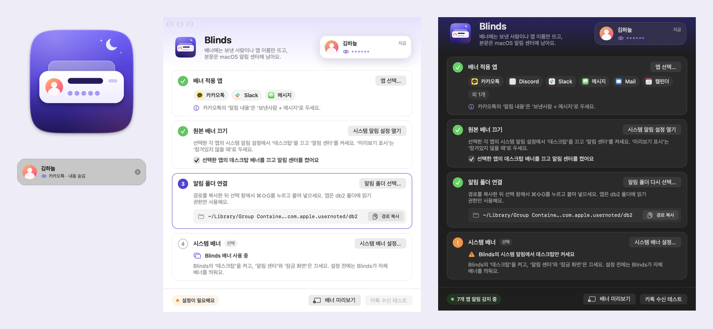

# Blinds

**배너에는 보낸 사람이나 앱 이름만, 메시지 본문은 macOS 알림 센터에서.**

Blinds는 선택한 앱의 데스크탑 배너에서 알림 본문을 가리는 메뉴 막대 앱입니다. 같은 알림의 원본 카드는 macOS 알림 센터에서 확인할 수 있습니다.

**0.3.1 빌드 6** · macOS 14 이상 · Apple Silicon / Intel 공용

[다운로드](#다운로드) · [화면 미리보기](#화면-미리보기) · [설치](#설치) · [처음 설정하기](#처음-설정하기) · [문제 해결](#문제-해결)

## 다운로드

| 환경 | 설치 파일 | 요구 사항 |
| --- | --- | --- |
| macOS | [DMG 다운로드][dmg] · [ZIP 다운로드][zip] | macOS 14 이상 · Apple Silicon / Intel 공용 |

두 형식에 동일한 Blinds 0.3.1 빌드가 들어 있습니다. 설치 파일과 SHA-256 체크섬은 [Blinds 0.3.1 릴리스][release]에서 받을 수 있습니다.

## 주요 기능

| 기능 | 할 수 있는 일 |
| --- | --- |
| 배너 적용 앱 선택 | 설정에서 여러 앱을 검색하고 고릅니다. 목록에 없는 앱은 직접 선택할 수 있습니다. |
| 배너의 본문 숨기기 | 카카오톡은 보낸 사람 이름을, 다른 앱은 앱 이름을 표시합니다. |
| 원본 알림 확인 | 알림 센터에서 본문을 읽고, 발신 앱이 제공하는 답장이나 정확한 항목 열기를 사용합니다. |
| 배너에서 앱 열기 | 배너를 누르면 알림을 보낸 앱을 엽니다. |
| macOS 시스템 배너 | Blinds의 데스크탑 알림을 켜면 macOS가 배너 표시와 닫기 동작을 처리합니다. |

## 화면 미리보기



설정 화면에는 적용 앱 선택, 원본 배너 설정, 알림 폴더 연결, 선택 사항인 시스템 배너 설정이 순서대로 표시됩니다. 그림 속 보낸 사람과 적용 앱 조합은 사용 예시입니다.

## 설치

1. [DMG][dmg]를 열고 `Blinds.app`을 **응용 프로그램** 폴더에 옮깁니다. [ZIP][zip]을 받았다면 압축을 풀고 같은 폴더에 옮깁니다.
2. Blinds를 실행한 뒤 화면 위쪽 **메뉴 막대의 Blinds 아이콘**에서 설정을 엽니다.
3. 기존 QuietBanner를 사용 중이라면 앱을 먼저 종료한 뒤 Blinds를 실행하세요. 0.3.1은 기존 앱 식별자를 사용해 저장된 적용 앱과 알림 설정을 이어받습니다.

배포판은 ad-hoc 서명된 미공증 빌드입니다. macOS가 첫 실행 때 경고를 표시하면 다운로드한 파일의 체크섬을 확인하고 Apple의 안내를 참고하세요. [Apple의 앱 실행 안내](https://support.apple.com/ko-kr/102445)

## 처음 설정하기

### 1. 적용할 앱 선택

Blinds 설정의 **앱 선택…**에서 적용하려는 앱을 체크하고 **적용**을 누릅니다. 카카오톡을 쓴다면 카카오톡 설정에서 **알림 내용 → 보낸사람 + 메시지**를 선택합니다.

### 2. 선택한 앱의 원본 배너 끄기

1. **시스템 설정 → 알림**에서 선택한 앱을 하나씩 엽니다. **알림 허용**과 **알림 센터**를 켠 상태로 **데스크탑**을 끕니다.
2. 이전 macOS에서는 알림 스타일을 **없음**으로 두고 **알림 센터에서 보기**를 켭니다. **미리보기 표시**는 **잠겨있지 않을 때**로 설정합니다.
3. Blinds로 돌아와 **선택한 앱의 데스크탑 배너를 끄고 알림 센터를 켰어요**를 체크합니다. [Apple 알림 설정](https://support.apple.com/ko-kr/guide/mac-help/mh40583/mac)

### 3. 알림 폴더 연결

1. Blinds에서 **경로 복사**, **알림 폴더 선택…** 순서로 누릅니다.
2. 선택 창에서 `⌘⇧G`를 눌러 경로를 붙여넣고 아래 폴더를 선택합니다.

```text
~/Library/Group Containers/group.com.apple.usernoted/db2
```

상태에 **앱 알림 감지 중**이 표시되면 **배너 미리보기**를 눌러 표시를 확인할 수 있습니다.

### 4. 시스템 배너 사용하기

Blinds의 **시스템 배너 설정…**에서 시스템 알림을 허용합니다. macOS 알림 설정의 **Blinds** 항목에서 **데스크탑**을 켜고 **알림 센터**와 **잠금 화면**을 끕니다. 이렇게 설정하면 알림 센터에는 발신 앱의 원본 카드가 남습니다.

설정이 끝나기 전에는 Blinds가 자체 배너를 표시합니다. 시스템 배너의 집중 모드 동작은 macOS에서 Blinds에 지정한 설정을 따릅니다.

## 알림 사용하기

- **배너 클릭**으로 발신 앱을 열 수 있습니다. 정확한 채팅방, 메일, 일정이나 답장 기능은 **알림 센터의 원본 카드**에서 선택합니다.
- **원본 카드 보기**는 메뉴 막대 오른쪽 위의 날짜와 시간을 눌러 알림 센터를 엽니다. 묶음으로 표시된 앱 알림은 펴서 확인합니다. [Apple 알림 센터 사용 안내](https://support.apple.com/ko-kr/guide/mac-help/mchl2fb1258f/mac)
- **일시 정지**는 Blinds 메뉴 막대 메뉴에서 선택합니다. 앱을 선택 해제한 뒤 기본 배너를 다시 쓰려면 macOS에서 해당 앱의 **데스크탑**을 켭니다.

## 알림과 개인정보

Blinds는 사용자가 지정한 `db2` 폴더를 읽기 전용으로 열고 선택한 앱의 알림을 확인합니다. 배너에 필요한 제목이나 앱 이름만 표시합니다. 원본 알림의 본문과 기록은 macOS가 관리합니다. 발신 앱에 설정된 알림 소리와 배지는 계속 해당 앱을 통해 처리됩니다.

## 문제 해결

| 증상 | 확인할 것 |
| --- | --- |
| 배너가 안 뜸 | 적용 앱이 선택됐는지, Blinds가 일시 정지 상태인지, 알림 폴더가 연결됐는지 확인합니다. 선택한 앱의 macOS 알림도 허용되어 있어야 합니다. |
| 배너가 두 번 뜸 | 선택한 앱의 **데스크탑**이 꺼져 있는지 확인합니다. Blinds의 데스크탑 알림은 시스템 배너를 사용할 때 켜 둡니다. |
| 알림 센터에서 본문이 안 보임 | 발신 앱의 **알림 센터**와 **미리보기 표시**를 확인합니다. 카카오톡에서는 **보낸사람 + 메시지**를 선택하고, 테스트할 때 새 알림의 채팅방을 열기 전에 알림 센터를 확인합니다. |
| 시스템 배너 사용 상태가 안 뜸 | Blinds 알림 허용을 켜고 표시 위치를 **데스크탑**으로만 설정합니다. 집중 모드나 화면 공유 중에는 macOS 알림 설정을 확인합니다. |
| 재실행 후 폴더 재선택 안내 | **알림 폴더 다시 선택…**에서 같은 `db2` 폴더를 연결합니다. |

## 0.3.1 버전 정보

- 앱 이름을 **QuietBanner**에서 **Blinds**로 변경했습니다.
- Blinds 이름과 앱 아이콘을 적용한 macOS 설치 파일을 제공합니다.
- 카카오톡 등 기존 적용 앱 설정을 이어받을 수 있도록 앱 식별자를 유지했습니다.

### 체크섬 확인

설치 파일과 해당 [.sha256 파일][release]을 같은 폴더로 받은 뒤, 그 폴더에서 명령을 실행합니다.

```sh
shasum -a 256 -c Blinds-0.3.1-macOS-universal.dmg.sha256
shasum -a 256 -c Blinds-0.3.1-macOS-universal.zip.sha256
```

받은 형식에 맞는 명령을 실행했을 때 `OK`가 표시되면 파일이 체크섬과 일치합니다.

### 배포 검증

DMG 무결성과 ZIP 압축을 확인했습니다. 두 패키지에서 0.3.1 빌드 6, 동일한 실행 파일, arm64·x86_64 아키텍처 및 앱 서명이 확인됐습니다. 이 확인은 패키지 검증이며 Intel 맥에서의 실행 검증은 별개입니다.

[dmg]: https://github.com/jiwoo-0929/Blinds/releases/download/blinds-v0.3.1/Blinds-0.3.1-macOS-universal.dmg
[zip]: https://github.com/jiwoo-0929/Blinds/releases/download/blinds-v0.3.1/Blinds-0.3.1-macOS-universal.zip
[release]: https://github.com/jiwoo-0929/Blinds/releases/tag/blinds-v0.3.1
